<div align="center">

# 🎯 job-fit-agent

### A resume tailoring agent that won't let you lie: every claim is linked to its evidence.

[](https://github.com/snikookar/job-fit-agent/actions/workflows/ci.yml)


[How it works](#-how-it-works) ·
[Architecture](#%EF%B8%8F-architecture) ·
[Fact-checking](#%EF%B8%8F-the-fact-check-three-layers-cheapest-first) ·
[Results](#-results) ·
[Quick start](#-quick-start) ·
[Build log](#-how-this-was-built)

</div>

---

Paste a job posting. The agent extracts its requirements, searches **your** resume, projects and GitHub READMEs for evidence, and computes an **explainable fit score**. It then rewrites your resume bullets and drafts a cover letter in which **every sentence cites the profile chunk it is based on**. A separate judge model rejects anything the evidence doesn't support. You review and approve, and get a Word file plus a card on your application tracker.

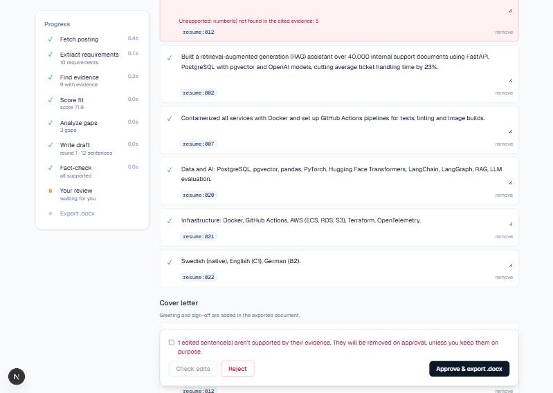
<sub>I edited a bullet to claim *"ran Kubernetes in production for 5 years"*. The fact-check flags it, and it is removed on approval unless I keep it on purpose.</sub>

## 💡 Why this exists

LLM resume tools are very good at writing confident sentences, and some of those sentences aren't true. They turn "followed a Kubernetes course" into "ran Kubernetes in production", add a year of experience here and there, or claim you *led* a team you were part of. That reads well right up until the interview.

This project treats tailoring as a **retrieval and verification problem** rather than a writing problem:

| | Typical AI resume writer | job-fit-agent |
|---|---|---|
| Source of truth | The model's imagination | Your indexed profile chunks |
| Every sentence | Free text | `{text, evidence_ids}` with a citation |
| Numbers ("5 years", "23%") | Invented freely | Must appear in the cited evidence |
| Fit score | A vibe, or an LLM guess | Deterministic arithmetic you can trace |
| Who checks the writer | Nobody | Code checks plus a judge from a **different model family** |
| Final say | The model | You, at a human-review checkpoint |

---

## 🔍 How it works

The agent is a **LangGraph** state machine with nine nodes, a writer ⇄ judge revision loop, and a human-in-the-loop pause that survives server restarts.

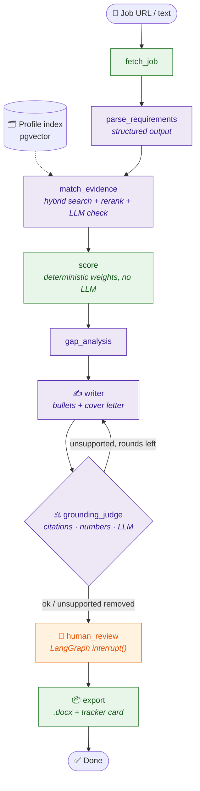

<sub>🟣 uses an LLM · 🟢 deterministic code · 🟠 waits for you</sub>

| Step | What happens |
|---|---|
| **Profile** | Resume (PDF/DOCX/MD), project write-ups and GitHub READMEs are split into small chunks: one per resume bullet, one per README section. Each is embedded with **bge-m3** |
| **Requirements** | An LLM extracts `JobRequirements` (must / nice, category, years). Greenhouse, Lever and Personio postings are read through their public APIs |
| **Evidence** | Per requirement: BM25 + dense search → reciprocal rank fusion → **bge-reranker-v2-m3** → a batched LLM check labels each chunk *full / partial / none* |
| **Score** | Plain arithmetic, no LLM: `100 × Σ(weight × strength) / Σ weight`, with must = 2, nice = 1. Every point traces back to a requirement and a chunk |
| **Draft** | Bullets and cover letter as `DraftSentence {text, evidence_ids}` |
| **Fact-check** | ① citations exist ② every number appears in the cited evidence ③ a **different** LLM judges each sentence against its evidence. Unsupported sentences go back to the writer once, then get removed and reported |
| **Review** | The graph pauses (`interrupt()` + checkpoint in Postgres). Your edits are fact-checked again |
| **Export** | python-docx (optionally with your own template) + tracker Kanban |

---

## 🏗️ Architecture

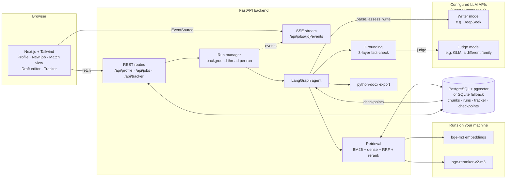

**Privacy by design:** embeddings and reranking run locally. Only the writer and judge calls you configure leave your machine. With no API keys, the app runs fully offline with rule-based stand-ins.

### A run, end to end

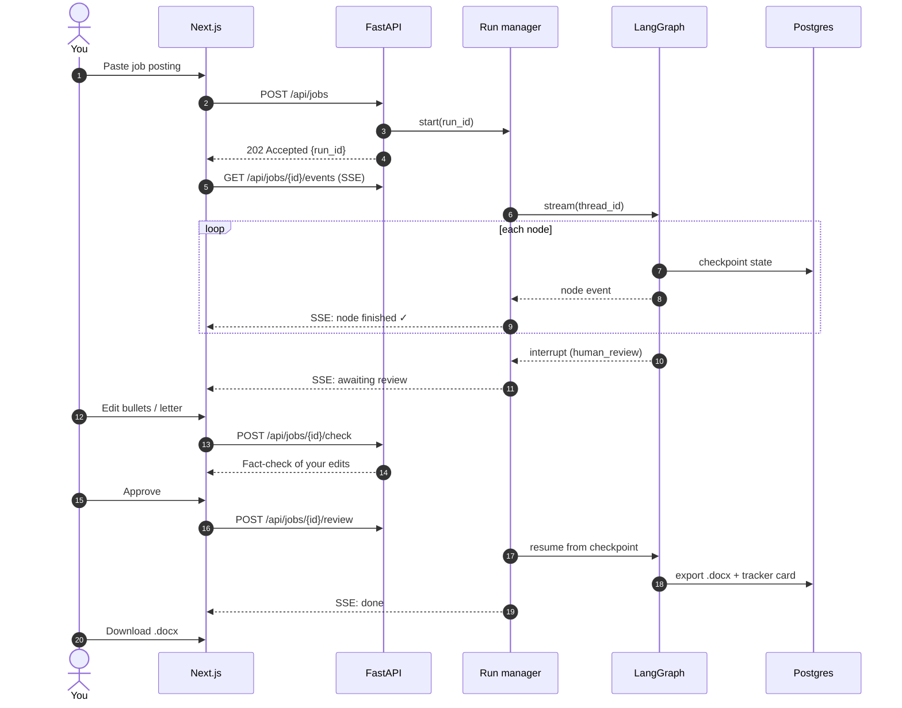

<details>
<summary><b>Run lifecycle and tracker states</b></summary>

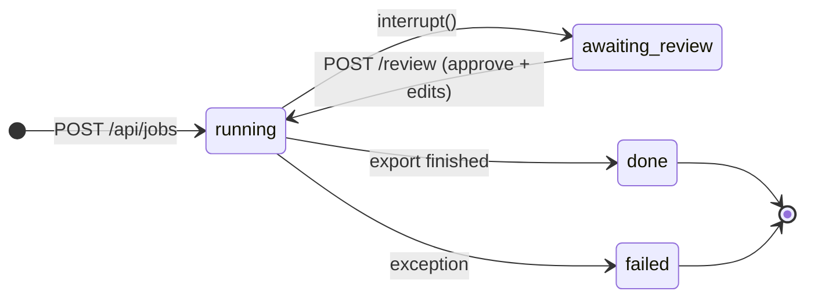

Every approved run creates a card on the tracker, which you move through the application pipeline:

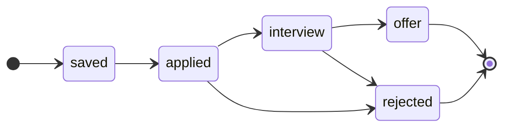

</details>

<details>
<summary><b>Data model</b></summary>

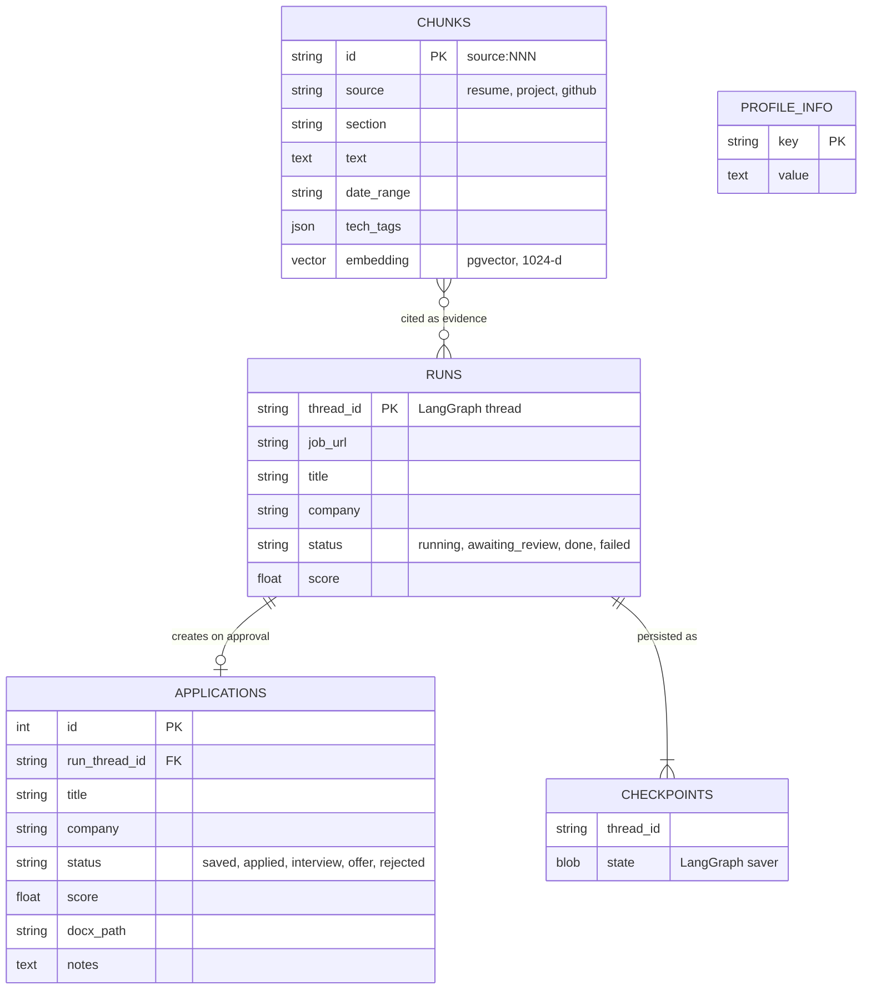

</details>

---

## 🔎 Evidence retrieval

Text similarity is not evidence. "Kubernetes" in a README section titled *Things I want to learn* is very similar to a Kubernetes requirement, and it proves nothing. Retrieval therefore ends in a **support verdict**, not a similarity score.

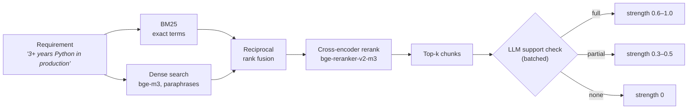

The verdict **gates** the strength and the reranker score only moves it within the verdict's range. A chunk the LLM labels *none* contributes nothing to the score, however similar it looks.

## 🧮 The score: plain arithmetic, fully traceable

$$\text{score} = 100 \times \frac{\sum_i w_i \cdot s_i}{\sum_i w_i} \qquad w_i = \begin{cases}2 & \text{must}\\1 & \text{nice}\end{cases} \qquad s_i = \text{best evidence strength} \in [0, 1]$$

An illustrative example with five requirements:

| Requirement | Importance | Weight | Best evidence | Strength | Contribution |
|---|---|---:|---|---:|---:|
| Python in production | must | 2 | full | 0.92 | 1.84 |
| LLM / RAG systems | must | 2 | full | 0.88 | 1.76 |
| Kubernetes | must | 2 | partial | 0.42 | 0.84 |
| AWS | nice | 1 | partial | 0.36 | 0.36 |
| German (B2) | nice | 1 | none | 0.00 | 0.00 |
| **Total** | | **8** | | | **4.80 → score 60.0** |

```mermaid
xychart-beta
    title "Where the points come from (possible vs earned)"
    x-axis ["Python", "LLM / RAG", "Kubernetes", "AWS", "German"]
    y-axis "weighted points" 0 --> 2.2
    bar [2, 2, 2, 1, 1]
    bar [1.84, 1.76, 0.84, 0.36, 0]
```

<sub>Light bars: the most a requirement can contribute. Dark bars: what your evidence earned. The match view also reports **must-coverage** (here 2 of 3 musts have strength ≥ 0.5) and turns every weak requirement into a gap with a suggestion.</sub>

---

## 🛡️ The fact-check: three layers, cheapest first

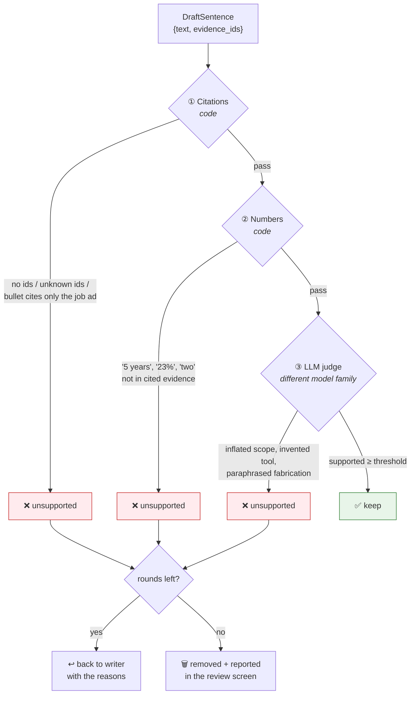

The two code layers cost nothing and trust no model. The judge is deliberately a **different model family** from the writer, so it doesn't share the writer's blind spots. Your own edits in the review screen go through the same checks.

---

## 📊 Results

The evaluation runs against a fictional profile with **100 planted fabrications** across 8 categories (see [`eval/`](eval/README.md)). The most important chart shows how many fabricated claims get caught with and without each layer of the fact-check:


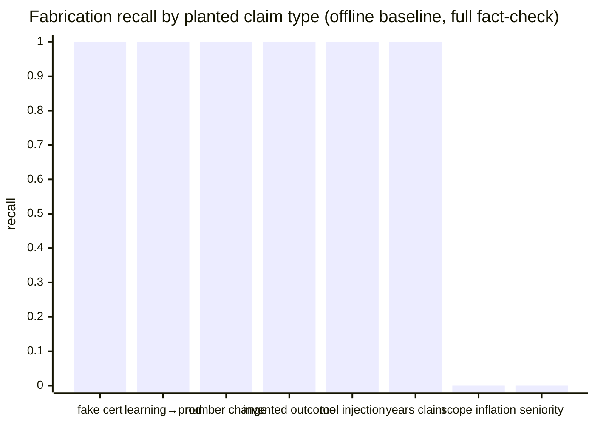

| Metric | Offline baseline (no API keys) | With LLMs | Target |
|---|---|---|---|
| Requirement extraction F1 (10 postings) | 1.00 ✅* | *run it* | ≥ 0.85 |
| Evidence retrieval Recall@5 (40 pairs) | 0.85 ❌ | *run it* | ≥ 0.90 |
| Score calibration (Spearman vs human) | 0.84 ✅ | *run it* | ≥ 0.70 |
| **Fabrication recall** (100 planted claims) | **0.79** ❌ | *run it* | ≥ 0.95 |
| False alarm rate (50 correct sentences) | 0.00 ✅ | *run it* | ≤ 0.10 |
| Latency per posting (to review step) | 0.27 s mean · 0.57 s p95 | *run it* | – |

What the offline baseline tells you:
- **The layers are complementary.** Code checks alone catch 46% of the fabrications and the judge alone 33%. Together they catch 79%, with zero false alarms.
- **The baseline misses inflated scope** ("led the team that…") and **seniority** claims. Those need semantic judgment from a real LLM judge, which is exactly what layer ③ is for.
- \* The 10 postings are synthetic with clean headings, so the extraction F1 is flattering. Real postings are needed (see [eval/README.md](eval/README.md)).

The offline baseline replaces the LLMs with rules and the embeddings with word hashing, so CI can run the full evaluation on every push with no API keys. To fill the "With LLMs" column, add API keys to `.env`, then:

```bash
cd backend
uv sync --extra ml
uv run python ../eval/run_eval.py --name api-deepseek-glm
```

---

## 🖼️ Screenshots

| Match view: score, requirements, gaps | Evidence drawer: the source behind a claim |
|---|---|
| 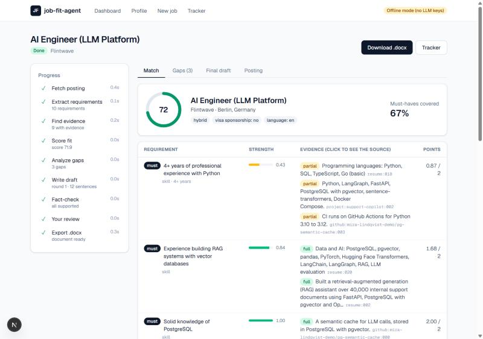 | 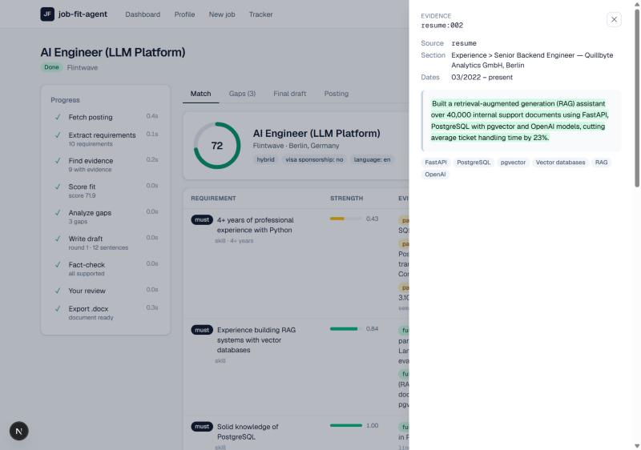 |

**Application tracker**
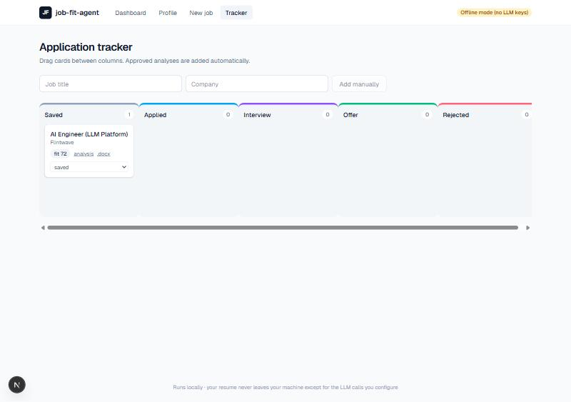

---

## 🚀 Quick start

### Option A: local (no Docker needed)

Requires [uv](https://docs.astral.sh/uv/) and Node 20+.

```bash
cp .env.example .env            # optional: add LLM API keys
cd backend
uv sync                         # add --extra ml for bge-m3 + reranker
uv run uvicorn jobfit.api.main:app --port 8000
```

In a second terminal:

```bash
cd frontend
npm install
npm run dev                     # http://localhost:3000
```

Open **Profile → Load demo profile**, then **New job**, and paste any posting.

Without API keys the app runs in **offline mode** (a badge says so) with rule-based stand-ins for the LLMs. That's good for trying the UI, but not for real applications.

### Option B: Docker

```bash
cp .env.example .env
docker compose up --build       # Postgres + pgvector, backend, frontend → http://localhost:3000
```

### CLI

```bash
cd backend
uv run jobfit load-sample
uv run jobfit analyze --file tests/fixtures/ai_engineer_berlin.md --approve
```

### Tests

```bash
cd backend
uv run pytest                   # 50 tests, no API keys needed
```

## ⚙️ Configuration

All settings are environment variables (see [`.env.example`](.env.example)):

| Variable | Default | Notes |
|---|---|---|
| `WRITER_BASE_URL` / `WRITER_API_KEY` / `WRITER_MODEL` | DeepSeek | Any OpenAI-compatible API |
| `JUDGE_BASE_URL` / `JUDGE_API_KEY` / `JUDGE_MODEL` | Zhipu GLM | Use a **different model family** from the writer |
| `DATABASE_URL` | SQLite file | `postgresql+psycopg://…` for pgvector |
| `EMBEDDING_BACKEND` / `RERANKER_BACKEND` | `auto` | bge models if installed, otherwise lightweight fallbacks |
| `JUDGE_THRESHOLD` | `0.5` | Raise it for a stricter judge, lower it if false alarms are too high |
| `MAX_DRAFT_ROUNDS` | `2` | Writer → judge rounds before unsupported sentences are removed |
| `EXPORT_TEMPLATE` | – | Your own .docx for styles, header and footer |
| `LANGFUSE_*` | – | Tracing (`uv sync --extra tracing`) |

## 🧰 Tech stack and why

| Layer | Choice | Why (details in [docs/phases](docs/phases)) |
|---|---|---|
| Agent | **LangGraph** | Conditional writer ⇄ judge loop, `interrupt()` for human review, Postgres checkpoints that survive restarts |
| LLMs | **DeepSeek** (writer) + **GLM** (judge) via the `openai` SDK | Two model families so the judge doesn't share the writer's blind spots. Any OpenAI-compatible provider works |
| Structured output | JSON mode + Pydantic + one repair retry | Works on every OpenAI-compatible provider |
| Embeddings / rerank | **bge-m3**, **bge-reranker-v2-m3** | Local (privacy), multilingual (German postings) |
| Search | BM25 + dense + RRF | Exact tech terms *and* paraphrases |
| DB | **PostgreSQL + pgvector** (SQLite fallback) | Profile, tracker and checkpoints in one database; zero-setup local runs |
| API | **FastAPI** + Server-Sent Events | Pydantic end to end, live node progress |
| Frontend | **Next.js** + Tailwind | Five screens, only three runtime dependencies |
| Parsing | PyMuPDF (Docling optional), trafilatura, Playwright fallback | Fast by default, heavier tools only when needed |
| Export | python-docx | Editable Word files, templates, evidence comments |
| Eval | Custom script + planted fabrications | Ground truth without hand-labeling every sentence |
| Infra | Docker Compose, GitHub Actions | CI runs on SQLite **and** Postgres + pgvector |

### Continuous integration

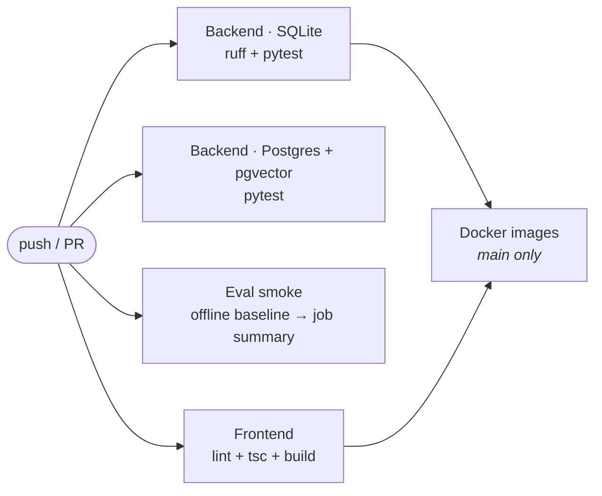

## 📁 Repository layout

```
backend/
  jobfit/
    api/          FastAPI app, routes, background runs + SSE
    graph/        graph.py, state.py, runner.py, nodes/ (one per node), prompts/*.md
    llm/          OpenAI-compatible client + offline heuristic provider
    profile/      parsing (PDF/DOCX/MD), chunking, GitHub, ingestion
    retrieval/    embeddings, reranker, pgvector/NumPy store, hybrid search
    grounding.py  three-layer fact-check
    scoring.py    deterministic score
    export/       .docx
  tests/          50 tests, no API keys needed
frontend/         Next.js app
eval/             labeled postings, retrieval pairs, fabrication set, run_eval.py
sample_profile/   Mira Lindqvist, a fictional persona for demos and evals
docs/             SPEC.md and a write-up for each build phase
```

## 📚 How this was built

The project was built in 10 phases. Each phase has a write-up covering the files created, the technology choices and the alternatives considered:

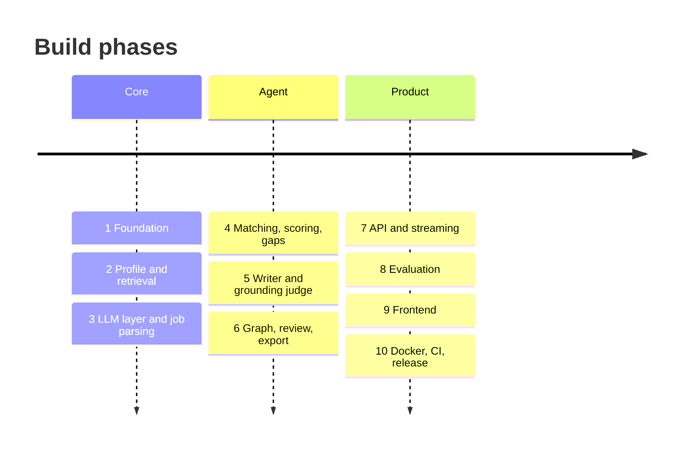

1. [Foundation](docs/phases/01-foundation.md): uv, settings, schemas, SQLite/pgvector models, the fictional profile
2. [Profile & retrieval](docs/phases/02-profile-and-retrieval.md): PDF parsing, chunking, bge-m3, hybrid search, reranking
3. [LLM layer & job parsing](docs/phases/03-llm-and-job-parsing.md): OpenAI-compatible client, offline provider, fetching
4. [Matching, scoring, gaps](docs/phases/04-matching-scoring-gaps.md): why similarity ≠ evidence, the deterministic score
5. [Writer & grounding judge](docs/phases/05-writer-and-grounding-judge.md): the three-layer fact-check and the revision loop
6. [Graph, review, export](docs/phases/06-graph-review-export.md): `interrupt()`, checkpoints, .docx, tracker, CLI
7. [API & streaming](docs/phases/07-api-and-streaming.md): FastAPI, background runs, SSE
8. [Evaluation](docs/phases/08-evaluation.md): planted fabrications, ablation, honest limitations
9. [Frontend](docs/phases/09-frontend.md): the five screens
10. [Docker, CI, release](docs/phases/10-docker-ci-release.md)

The full design is in [docs/SPEC.md](docs/SPEC.md).

## 🔒 Privacy

- Runs locally. There's no login, so **don't expose it on a public server**. Docker binds every port to `127.0.0.1`.
- Embeddings and reranking run on your machine. Only the LLM calls you configure leave it.
- The public demo, tests and evals use the fictional `sample_profile/`. Don't commit your real resume: `backend/data/` and `.env` are git-ignored.

## 🧭 Limitations and next steps

- [ ] Evaluate on **30 real postings** and 100 retrieval pairs, as the spec asks (the current set is synthetic and smaller).
- [ ] Run the eval with real LLMs and publish those numbers next to the offline baseline.
- [ ] Compute years of experience deterministically from date ranges instead of asking the LLM.
- [ ] Multi-user support would need auth, per-user data and a job queue. It's single-user by design for now.
- Auto-applying and LinkedIn scraping are out of scope on purpose.

## 📄 License

[MIT](LICENSE)
