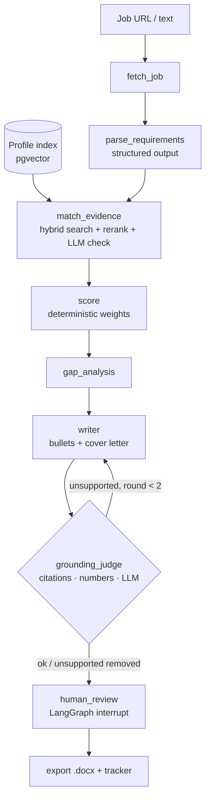

# job-fit-agent

> **A resume tailoring tool that won't let you lie: every claim is linked to its evidence.**

[](https://github.com/YOUR_GITHUB_USERNAME/job-fit-agent/actions/workflows/ci.yml)


Paste a job posting. The agent extracts its requirements, searches **your** resume, projects and GitHub READMEs for evidence, and computes an explainable fit score. It then rewrites your resume bullets and drafts a cover letter in which **every sentence cites the profile chunk it is based on**. A separate judge model rejects anything the evidence doesn't support. You review and approve, and get a Word file plus a card on your application tracker.


<sub>I edited a bullet to claim *"ran Kubernetes in production for 5 years"*. The fact-check flags it, and it is removed on approval unless I keep it on purpose.</sub>

---

## How it works



| Step | What happens |
|---|---|
| **Profile** | Resume (PDF/DOCX/MD), project write-ups and GitHub READMEs are split into small chunks: one per resume bullet, one per README section. Each is embedded with **bge-m3** |
| **Requirements** | An LLM extracts `JobRequirements` (must / nice, category, years). Greenhouse, Lever and Personio postings are read through their public APIs |
| **Evidence** | Per requirement: BM25 + dense search → reciprocal rank fusion → **bge-reranker-v2-m3** → a batched LLM check labels each chunk *full / partial / none* |
| **Score** | Plain arithmetic, no LLM: `100 × Σ(weight × strength) / Σ weight`, with must = 2, nice = 1. Every point traces back to a requirement and a chunk |
| **Draft** | Bullets and cover letter as `DraftSentence {text, evidence_ids}` |
| **Fact-check** | ① citations exist ② every number appears in the cited evidence ③ a **different** LLM judges each sentence against its evidence. Unsupported sentences go back to the writer once, then get removed and reported |
| **Review** | The graph pauses (`interrupt()` + checkpoint in Postgres). Your edits are fact-checked again |
| **Export** | python-docx (optionally with your own template) + tracker Kanban |

## Results

The evaluation runs against a fictional profile with planted fabrications (see [`eval/`](eval/README.md)). **The most important chart: how many fabricated claims get caught, with and without the judge.**


| Metric | Offline baseline (no API keys) | With LLMs | Target |
|---|---|---|---|
| Requirement extraction F1 (10 postings) | 1.00* | *run it* | ≥ 0.85 |
| Evidence retrieval Recall@5 (40 pairs) | 0.85 | *run it* | ≥ 0.90 |
| Score calibration (Spearman vs human) | 0.84 | *run it* | ≥ 0.70 |
| **Fabrication recall** (100 planted claims) | **0.79** | *run it* | ≥ 0.95 |
| False alarm rate (50 correct sentences) | 0.00 | *run it* | ≤ 0.10 |

The offline baseline replaces the LLMs with rules and the embeddings with word hashing. It tells you a few things:
- **The layers are complementary.** Code checks alone catch 46% of the fabrications and the judge alone 33%; together they catch 79%.
- **The baseline misses inflated scope** ("led the team that…") and **seniority** claims, which need semantic judgment from a real LLM judge.
- \* The 10 postings are synthetic with clean headings, so extraction F1 is flattering. Real postings are needed (see [eval/README.md](eval/README.md)).

To fill the "With LLMs" column: add API keys to `.env`, run `uv sync --extra ml`, then `uv run python ../eval/run_eval.py --name api-deepseek-glm`.

## Quick start

### Option A: local (no Docker needed)

Requires [uv](https://docs.astral.sh/uv/) and Node 20+.

```bash
cp .env.example .env            # optional: add LLM API keys
cd backend
uv sync                         # add --extra ml for bge-m3 + reranker
uv run uvicorn jobfit.api.main:app --port 8000
```

In a second terminal:

```bash
cd frontend
npm install
npm run dev                     # http://localhost:3000
```

Open **Profile → Load demo profile**, then **New job**, and paste any posting.

Without API keys the app runs in **offline mode** (a badge says so): rule-based stand-ins for the LLMs. That's good for trying the UI, but not for real applications.

### Option B: Docker

```bash
cp .env.example .env
docker compose up --build       # Postgres + pgvector, backend, frontend → http://localhost:3000
```

### CLI

```bash
cd backend
uv run jobfit load-sample
uv run jobfit analyze --file tests/fixtures/ai_engineer_berlin.md --approve
```

## Configuration

All settings are environment variables (see [`.env.example`](.env.example)):

| Variable | Default | Notes |
|---|---|---|
| `WRITER_BASE_URL` / `WRITER_API_KEY` / `WRITER_MODEL` | DeepSeek | Any OpenAI-compatible API |
| `JUDGE_BASE_URL` / `JUDGE_API_KEY` / `JUDGE_MODEL` | Zhipu GLM | Use a **different model family** from the writer |
| `DATABASE_URL` | SQLite file | `postgresql+psycopg://…` for pgvector |
| `EMBEDDING_BACKEND` / `RERANKER_BACKEND` | `auto` | bge models if installed, otherwise lightweight fallbacks |
| `JUDGE_THRESHOLD` | `0.5` | Raise it for a stricter judge, lower it if false alarms are too high |
| `MAX_DRAFT_ROUNDS` | `2` | Writer → judge rounds before unsupported sentences are removed |
| `EXPORT_TEMPLATE` | – | Your own .docx for styles, header and footer |
| `LANGFUSE_*` | – | Tracing (`uv sync --extra tracing`) |

## Screenshots

| Match view | Evidence source |
|---|---|
|  |  |


## Tech stack and why

| Layer | Choice | Why (details in [docs/phases](docs/phases)) |
|---|---|---|
| Agent | **LangGraph** | Conditional writer ⇄ judge loop, `interrupt()` for human review, Postgres checkpoints that survive restarts |
| LLMs | **DeepSeek** (writer) + **GLM** (judge) via the `openai` SDK | Two model families so the judge doesn't share the writer's blind spots. Any OpenAI-compatible provider works |
| Structured output | JSON mode + Pydantic + one repair retry | Works on every OpenAI-compatible provider |
| Embeddings / rerank | **bge-m3**, **bge-reranker-v2-m3** | Local (privacy), multilingual (German postings) |
| Search | BM25 + dense + RRF | Exact tech terms *and* paraphrases |
| DB | **PostgreSQL + pgvector** (SQLite fallback) | Profile, tracker and checkpoints in one database; zero-setup local runs |
| API | **FastAPI** + Server-Sent Events | Pydantic end to end, live node progress |
| Frontend | **Next.js** + Tailwind | Five screens, only three runtime dependencies |
| Parsing | PyMuPDF (Docling optional), trafilatura, Playwright fallback | Fast by default, heavier tools only when needed |
| Export | python-docx | Editable Word files, templates, evidence comments |
| Eval | Custom script + planted fabrications | Ground truth without hand-labeling every sentence |
| Infra | Docker Compose, GitHub Actions | CI runs on SQLite **and** Postgres + pgvector |

## Repository layout

```
backend/
  jobfit/
    api/          FastAPI app, routes, background runs + SSE
    graph/        graph.py, state.py, runner.py, nodes/ (one per node), prompts/*.md
    llm/          OpenAI-compatible client + offline heuristic provider
    profile/      parsing (PDF/DOCX/MD), chunking, GitHub, ingestion
    retrieval/    embeddings, reranker, pgvector/NumPy store, hybrid search
    grounding.py  three-layer fact-check
    scoring.py    deterministic score
    export/       .docx
  tests/          50 tests, no API keys needed
frontend/         Next.js app
eval/             labeled postings, retrieval pairs, fabrication set, run_eval.py
sample_profile/   Mira Lindqvist, a fictional persona for demos and evals
docs/             SPEC.md and a write-up for each build phase
```

## How this was built

The project was built in 10 phases. Each phase has a write-up covering the files created, the technology choices and the alternatives considered:

1. [Foundation](docs/phases/01-foundation.md): uv, settings, schemas, SQLite/pgvector models, the fictional profile
2. [Profile & retrieval](docs/phases/02-profile-and-retrieval.md): PDF parsing, chunking, bge-m3, hybrid search, reranking
3. [LLM layer & job parsing](docs/phases/03-llm-and-job-parsing.md): OpenAI-compatible client, offline provider, fetching
4. [Matching, scoring, gaps](docs/phases/04-matching-scoring-gaps.md): why similarity ≠ evidence, the deterministic score
5. [Writer & grounding judge](docs/phases/05-writer-and-grounding-judge.md): the three-layer fact-check and the revision loop
6. [Graph, review, export](docs/phases/06-graph-review-export.md): `interrupt()`, checkpoints, .docx, tracker, CLI
7. [API & streaming](docs/phases/07-api-and-streaming.md): FastAPI, background runs, SSE
8. [Evaluation](docs/phases/08-evaluation.md): planted fabrications, ablation, honest limitations
9. [Frontend](docs/phases/09-frontend.md): the five screens
10. [Docker, CI, release](docs/phases/10-docker-ci-release.md)

## Privacy

- Runs locally. There's no login, so **don't expose it on a public server**. Docker binds every port to `127.0.0.1`.
- Embeddings and reranking run on your machine. Only the LLM calls you configure leave it.
- The public demo, tests and evals use the fictional `sample_profile/`. Don't commit your real resume: `backend/data/` and `.env` are git-ignored.

## Limitations and next steps

- Evaluate on **30 real postings** and 100 retrieval pairs, as the spec asks (the current set is synthetic and smaller).
- Run the eval with real LLMs and publish those numbers next to the offline baseline.
- Years of experience are judged by the LLM from date ranges; computing them deterministically would be more reliable.
- Single-user by design. Multi-user would need auth, per-user data and a job queue.
- Auto-applying and LinkedIn scraping are out of scope on purpose.

## License

[MIT](LICENSE)
