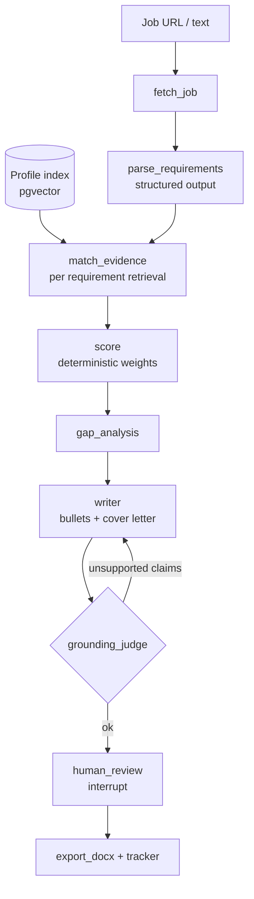

# 4. `job-fit-agent`: Resume-to-Job Fit Analysis

> **Difficulty:** Medium · **Time:** 2–3 weeks · **Skills:** Multi-agent (LangGraph), RAG, structured output, hallucination detection, human-in-the-loop

---

## 1. Summary

The user provides the text or link of a job posting. The system:

1. Extracts the posting's requirements as structured data: required and preferred skills, years of experience, language and location.
2. For each requirement, uses RAG to search the user's resume and projects for **evidence**.
3. Produces an explainable fit score and a list of gaps.
4. Rewrites resume bullets for this posting and drafts a cover letter.
5. **Every generated sentence must link to real evidence in the user's profile.** A judge catches unsupported claims.
6. The user reviews and approves the final version. A Word file is exported and the application is logged in a tracker.

### Key message for the README

> "A resume tailoring tool that won't let you lie: every claim is linked to its evidence."

---

## 2. Scope

### MVP

- Job input: pasted text, or links to public pages (Greenhouse, Lever, Personio, Workable and company career sites)
- Profile input: resume PDF, plus project Markdown files and GitHub repo READMEs
- Requirement extraction, matching, scoring and gap list
- Bullet rewriting and cover letter, with a grounding check
- Human review before the final output
- Word (.docx) export and an application tracker (simple Kanban)

### Out of scope

- Auto-applying to jobs
- Scraping LinkedIn, which violates LinkedIn's terms of use. For LinkedIn postings, the user pastes the text.

---

## 3. Architecture (LangGraph graph)



### Nodes

| Node | Job | Output |
|---|---|---|
| `fetch_job` | Playwright or trafilatura, HTML cleanup and language detection | Clean job text |
| `parse_requirements` | LLM with structured output | `JobRequirements` |
| `match_evidence` | For each requirement, hybrid search over the profile, then rerank | List of evidence with `chunk_id` |
| `score` | **Deterministic code:** required weight 2, preferred weight 1, multiplied by evidence strength (0–1) | Score 0–100, with breakdown |
| `gap_analysis` | Requirements without enough evidence, plus suggestions to close the gap | `Gap[]` |
| `writer` | Rewrites bullets and the cover letter. **Every sentence must have `evidence_ids`** | `Draft` |
| `grounding_judge` | A separate LLM checks whether each sentence follows from its evidence | `supported` / `unsupported` |
| `human_review` | `interrupt()` in LangGraph; the user edits or approves | Final draft |
| `export` | python-docx with a resume template, and logging in the tracker | .docx file |

The writer–judge loop runs at most 2 times. If unsupported claims remain after that, those sentences are removed and reported to the user.

---

## 4. Data Models

```python
class Requirement(BaseModel):
    id: str
    text: str
    category: Literal["skill", "experience", "education", "language", "location", "other"]
    importance: Literal["must", "nice"]
    years: int | None = None

class JobRequirements(BaseModel):
    title: str
    company: str | None
    location: str | None
    remote: Literal["onsite", "hybrid", "remote", "unknown"]
    visa_sponsorship: Literal["yes", "no", "unknown"]
    requirements: list[Requirement]

class Evidence(BaseModel):
    requirement_id: str
    chunk_id: str
    quote: str
    strength: float  # 0..1, from reranker score + judge

class DraftSentence(BaseModel):
    text: str
    evidence_ids: list[str]

class Draft(BaseModel):
    bullets: list[DraftSentence]
    cover_letter: list[DraftSentence]
```

### Profile index

- **Sources:** resume (via Docling), `projects/*.md` files, and GitHub repo READMEs (via the `gh` API or cloning)
- **Chunking:** each resume bullet is one chunk, and each README section is one chunk
- **Metadata:** `source`, `section`, `date_range` and `tech_tags`

---

## 5. Tech Stack

| Layer | Tools |
|---|---|
| Agent | LangGraph (with `interrupt` and `PostgresSaver`) |
| LLM | DeepSeek or GLM API. The judge uses a different model from the writer so they don't share the same failure modes |
| Fetching | Playwright, trafilatura |
| Resume parsing | Docling (or PyMuPDF) |
| Embeddings and rerank | `bge-m3`, `bge-reranker-v2-m3` |
| DB | PostgreSQL + pgvector (profile, tracker and checkpoints) |
| Backend | FastAPI (streaming node status via SSE) |
| Frontend | Next.js + Tailwind: match view, bullet diff and tracker Kanban |
| Export | python-docx |
| Eval | DeepEval, and a custom script |
| Tracing | Langfuse |
| Infrastructure | Docker Compose, GitHub Actions |

---

## 6. Repo Structure

```
job-fit-agent/
├── backend/
│   ├── api/                  # FastAPI routes (jobs, profile, drafts, tracker)
│   ├── graph/
│   │   ├── graph.py
│   │   ├── nodes/            # one file per node
│   │   └── prompts/
│   ├── profile/ingest.py     # CV + projects + GitHub READMEs
│   ├── retrieval/
│   ├── scoring.py            # deterministic
│   ├── export/docx.py
│   └── db/
├── frontend/                 # Next.js
├── eval/
│   ├── jobs/                 # 30 labeled job postings
│   ├── fabrication_set.jsonl
│   └── run_eval.py
├── sample_profile/           # fictional persona for public demo
├── docker-compose.yml
└── README.md
```

**Note:** Use a fictional profile (`sample_profile/`) for the public demo, not your real resume.

---

## 7. Evaluation

| Metric | Data | Method | Target |
|---|---|---|---|
| Requirement extraction F1 | 30 real postings labeled by hand (AI Engineer, Backend and Full-stack in Europe) | Compare requirement lists | ≥ 0.85 |
| Evidence retrieval Recall@5 | 100 requirement–evidence pairs | Retrieval | ≥ 0.9 |
| Score calibration | 30 postings rated 1–5 by a human | Spearman correlation | ≥ 0.7 |
| **Fabrication detection** | 100 drafts with deliberately planted fake claims ("5 years of Kubernetes") | The judge must catch them | Recall ≥ 0.95 |
| False alarm rate | Fully correct drafts | The judge shouldn't reject them | ≤ 10% |
| Latency and cost | Each posting end to end | Langfuse | Reported |

**The most important chart in the README:** fabrication recall with and without the judge.

---

## 8. User Interface (Next.js)

1. **Profile:** upload resume, connect GitHub, view indexed chunks
2. **New job:** paste or link a posting, with live node progress
3. **Match view:** table of requirements, evidence and scores. Clicking evidence shows the source chunk
4. **Draft editor:** diff of old and new bullets. Unsupported sentences are highlighted in red
5. **Tracker:** Kanban with Saved, Applied, Interview, Offer and Rejected columns

---

## 9. Timeline

### Week 1: backend core

| Day | Work |
|---|---|
| 1 | Repo, Docker, DB, schemas and fictional profile |
| 2 | Profile ingestion (Docling and GitHub), embeddings and retrieval |
| 3 | `fetch_job` and `parse_requirements`, and label 30 postings |
| 4 | `match_evidence`, `score` and `gap_analysis` |
| 5 | `writer` and `grounding_judge` and the loop between them |

### Week 2: eval and API

| Day | Work |
|---|---|
| 6 | Human review (interrupt), docx export and tracker |
| 7 | FastAPI and status streaming |
| 8 | Build the fabrication set and run evals |
| 9 | Error analysis and prompt improvements |
| 10 | Results table |

### Week 3: frontend and release

| Day | Work |
|---|---|
| 11–13 | Next.js pages |
| 14 | README, demo GIF, CI and LinkedIn post |

---

## 10. Definition of Done

- [ ] The full flow runs: posting, match, draft, review and .docx export
- [ ] Every output sentence links to its evidence in the UI
- [ ] Fabrication recall ≥ 0.95 is reported with numbers in the README
- [ ] Public demo uses the fictional profile
- [ ] Tests and CI pass

---

## 11. Risks

| Risk | Mitigation |
|---|---|
| Job sites block scraping | Pasted text is the main path; fetching only for public pages |
| Judge is too strict | Measure false alarms and tune the threshold |
| Resume privacy | Run locally, store nothing on a public server, and use the fictional profile for demos |
