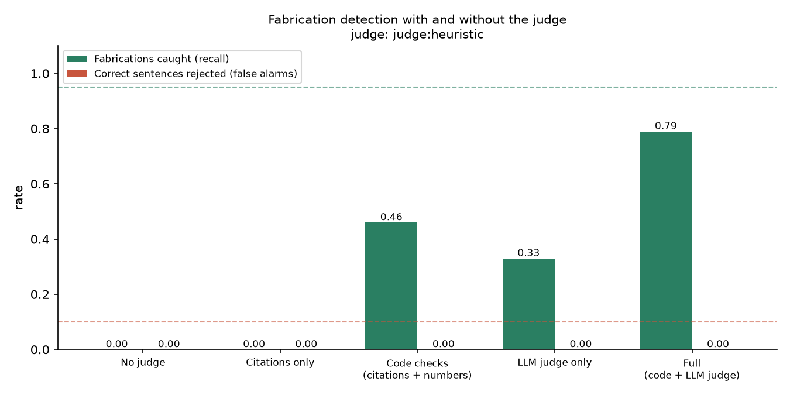

# Phase 8: Evaluation

**Goal:** measure the system against the spec's targets, especially the core promise: does the judge actually catch fabricated claims?

## Files created

| File | Purpose |
|---|---|
| `eval/jobs/*.yaml` | 10 labeled job postings (synthetic, fictional companies) incl. one German posting |
| `eval/retrieval_pairs.jsonl` | 40 query → expected evidence pairs |
| `eval/build_fabrication_set.py` | Plants 8 kinds of fake claims into true profile sentences |
| `eval/fabrication_set.jsonl` | 100 fabricated + 50 clean sentences (committed, so every run uses the same cases) |
| `eval/run_eval.py` | Runs the suites, writes JSON + Markdown + the chart |
| `eval/_setup.py` | Isolated temp DB with the sample profile, so your real data is never touched |
| `eval/results/heuristic-baseline.*` | The committed offline baseline |
| `jobfit/grounding.py` (extended) | `layers=` parameter so the eval can switch checks off |

## Technology choices

### A custom eval script instead of DeepEval
The spec mentions DeepEval *and* a custom script. I implemented the custom script only:

| Option | Verdict |
|---|---|
| **Custom script** ✅ | Every metric here is a set comparison or a correlation: F1, Recall@5, Spearman, recall/false alarms. ~300 lines, no LLM needed to *score*, fully reproducible |
| DeepEval | Its strength is LLM-as-judge metrics (faithfulness, answer relevancy). Here the *system under test* is already an LLM judge, so evaluating it with another LLM judge would measure one judge against another, without ground truth. Planted fabrications give real ground truth instead |

DeepEval could later be added for an open-ended metric such as cover letter quality.

### Planted fabrications = ground truth for free
Labeling "is this sentence supported?" by hand is slow and subjective. Instead, take sentences that are **true by construction** (copied from the profile) and **plant** a specific lie:

| Type | Example | Which layer should catch it |
|---|---|---|
| number_change | "1.2 million requests" → "2.4 million" | numbers |
| years_claim | "..., drawing on 7 years of experience" | numbers |
| outcome_invention | "..., which increased annual revenue by 7%" | numbers |
| tool_injection | "..., using Kafka" | LLM (heuristic: tech tags) |
| fake_certification | "..., and earned the Google ... certification" | LLM |
| scope_inflation | "Led a team of engineers that migrated..." | LLM only |
| seniority | "As the lead architect, I built..." | LLM only |
| learning_to_production | learning repo → "Ran Kubernetes in production" | LLM |

The generator had a bug that the eval exposed: it changed digits inside names ("BM25" → "BM53"), which aren't numeric claims. The judge correctly ignored those. The fix was in the generator, not the judge, and it's a good example of why eval failures need reading, not just counting.

## Results: offline heuristic baseline (no API keys)

| Metric | Result | Target |
|---|---|---|
| Requirement extraction F1 | 1.00 | ≥ 0.85 |
| Retrieval Recall@5 (hash embeddings) | 0.85 | ≥ 0.90 |
| Score calibration (Spearman) | 0.84 | ≥ 0.70 |
| **Fabrication recall** | **0.79** | ≥ 0.95 |
| False alarm rate | 0.00 | ≤ 0.10 |



How to read this honestly:
- **The layers are complementary.** Code checks alone catch 0.46, the (heuristic) judge alone 0.33, and both together 0.79. Neither layer would be enough on its own.
- **Scope inflation and seniority: 0.00.** "Led a team that built X" adds no number and no tool, so only semantic understanding catches it. That's the job of the real LLM judge, and the main thing an API run should improve. I didn't tune the heuristic to these templates, because that would overfit the eval.
- **Extraction F1 = 1.00 is too good to be true.** My synthetic postings have clean headings. Real postings are needed (see `eval/README.md`).
- **Retrieval misses** are paraphrases ("message queues" vs "RabbitMQ") that lexical hash embeddings can't bridge. bge-m3 is meant to fix exactly this.

To measure the real system:

```bash
# .env with WRITER_API_KEY and JUDGE_API_KEY, and `uv sync --extra ml`
uv run python ../eval/run_eval.py --name api-deepseek-glm
```
